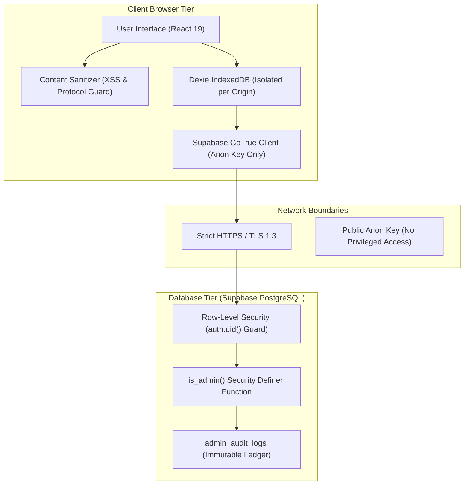

# 06. Security and Data Ownership Architecture

> **Audit Date:** 2026-10-29  
> **Repository:** `language-learning`  
> **Scope:** Authentication boundaries, Row-Level Security, threat model, input sanitization, guest isolation, and data ownership.

---

## 1. Security Architecture & Threat Model

The application enforces a defense-in-depth model across browser execution, network communication, and database transactions:



---

## 2. Key Separation & Credential Boundaries

1. **Client Anon Key (`VITE_SUPABASE_ANON_KEY`):** Public key with zero administrative privileges. All requests made using this key are subject to Row-Level Security policies.
2. **Server Service-Role Key (`SUPABASE_SERVICE_ROLE_KEY`):** Never exposed to frontend code or client bundles. Kept strictly within GitHub Actions repository secrets for automated daily batch runners (`scripts/run_daily_batch.py`) and administrative provisioning (`scripts/bootstrap_admin.py`).
3. **No Embedded Secrets:** Static build output (`tsc -b && vite build`) undergoes verification to confirm zero leaked tokens or service keys.

---

## 3. Server-Enforced Administrative Authorization

A critical architectural invariant is that frontend role flags are treated strictly as presentation conveniences:
```typescript
// Frontend presentation check only:
const isAdmin = authService.getState().role === 'admin';
```
Backend database operations strictly enforce authorization via `006_auth_roles_audit_and_onboarding.sql`:
```sql
CREATE OR REPLACE FUNCTION is_admin(user_uuid UUID)
RETURNS BOOLEAN AS $$
  SELECT EXISTS (
    SELECT 1 FROM user_roles
    WHERE user_id = user_uuid AND role = 'admin'
  );
$$ LANGUAGE sql SECURITY DEFINER;
```
Ordinary users cannot update `user_roles` or forge administrative audit entries.

---

## 4. Input Sanitization & Content Security (`contentSanitizer.ts`)

All user inputs and external educational content pass through `frontend/src/lib/security/contentSanitizer.ts`:
- **XSS Protection:** Strips `<script>`, `<iframe>`, `<object>`, and malicious event handlers (`onload`, `onerror`).
- **Safe Protocols:** Links to external cultural articles are strictly validated against `https://`.
- **Typographic Preservation:** Legitimate linguistic characters (`ñ`, `ç`, `ã`, `é`), IPA tone marks (`[ʁ]`, `[θ]`), and formatting remain completely intact.

---

## 5. Guest Data Isolation & Account Migration

1. **Guest Isolation:** Unauthenticated learners study with full offline persistence in Dexie IndexedDB.
2. **Safe Migration Policy:** Upon account creation or sign-in, the user is presented with an explicit prompt (`auth_guest_migration_prompt`):
   - Option A: **Import Guest Progress** — Transfers local offline lessons, vocabulary bookmarks, and SRS history to the new user ID.
   - Option B: **Start Fresh** — Discards guest data to prevent cross-account pollution.
3. **Account Sign-Out:** Clearing session state purges in-memory caches, preventing User B from viewing User A's private study records on a shared machine.
