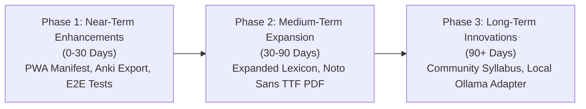

# 09. Recommended Roadmap and Evolution Strategy

> **Audit Date:** 2026-10-29  
> **Repository:** `language-learning`  
> **Scope:** Prioritized engineering initiatives, architectural enhancements, and pedagogical extensions.

---

## 1. Prioritized Roadmap Overview

---

## 2. Phase 1: Near-Term Enhancements (Priority 1 — Next 30 Days)

1. **Progressive Web App (PWA) Manifest & Service Worker**:
   - *Rationale:* Enable true single-tap home screen installation on iOS and Android devices with offline caching of static assets.
   - *Implementation:* Integrate `vite-plugin-pwa` with precached app shell and IndexedDB data persistence.
2. **Anki (.apkg) Flashcard Deck Export**:
   - *Rationale:* Allow power learners to export their SM-2 review queue and personalized mistake notebook to Anki for mobile study.
   - *Implementation:* Client-side generation of Anki-compatible CSV or SQLite `.apkg` packages using open zip utilities.
3. **Automated Playwright End-to-End Tests**:
   - *Rationale:* Complement unit tests with visual regression and keyboard navigation verification across 360px, 768px, and 1280px viewports.

---

## 3. Phase 2: Medium-Term Expansion (Priority 2 — 30 to 90 Days)

1. **Expanded Lexicon & Corpus (Top 1,000 Lemmas)**:
   - *Rationale:* Deepen vocabulary breadth from current top 200 items to top 1,000 items per language track, tagged with verified CEFR levels and frequency rankings.
2. **Embedded Noto Sans TTF for PDF Generation**:
   - *Rationale:* Guarantee 100% typographic fidelity for complex International Phonetic Alphabet (IPA) symbols and dialect diacritics in generated PDF study packs.
3. **Advanced Sociolinguistic Audio Clips**:
   - *Rationale:* Expand Tatoeba audio links with curated open recordings featuring authentic European Portuguese, Rioplatense Spanish, and Mexican colloquial speech.

---

## 4. Phase 3: Long-Term Innovations (Priority 3 — 90+ Days)

1. **Community Open Cultural Syllabus**:
   - *Rationale:* Allow educators to submit open-license cultural reading passages, festivals, and grammar exercises via GitHub Pull Requests.
2. **Optional Local Ollama Adapter (Strict Circuit-Breaker)**:
   - *Rationale:* For learners with local GPU hardware, offer optional offline lexis explanation enrichment via open models (e.g., Llama 3 / Mistral), while preserving the zero-paid-API deterministic fallback as the primary system engine.
