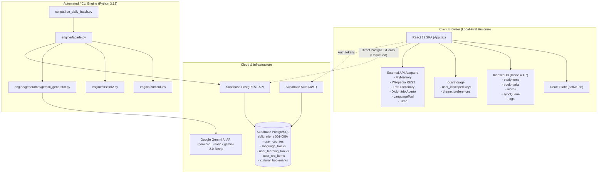

# Lexilume — Current State Architecture & Engineering Audit

> **Document:** `docs/redesign/01_CURRENT_STATE_AUDIT.md`  
> **Status:** Completed Comprehensive Audit  
> **Target Application:** Lexilume (`https://lexi.monster`)  
> **Repository:** `VINODH0101/language-learning`  
> **Execution Date:** October 2026  

---

## 1. Executive Summary

This document establishes the verified baseline of the **Lexilume** codebase prior to any architectural redesign. Lexilume is a multilingual language learning platform designed to operate on a **Zero-Paid AI Mandate** and **Local-First Architecture**, providing structured CEFR-aligned lessons, spaced repetition (SM-2), vocabulary management, cultural exploration, and diagnostic placement.

Every finding in this document has been verified against the repository source code and local test runners.

---

## 2. Technology Stack & Runtime Environment

### 2.1 Frontend Stack

| Layer | Package / Technology | Version | Purpose & Notes |
| :--- | :--- | :--- | :--- |
| **Framework** | `react`, `react-dom` | `19.3.1` | Modern React with Server Component support capability, running client-side. |
| **Language** | `typescript` | `~7.0.2` | Strict mode typing (`frontend/tsconfig.json`). |
| **Build Tool** | `vite` | `^8.3.5` | Fast ESM development server and Rollup-based production bundler. |
| **Styling** | `tailwindcss`, `@tailwindcss/vite` | `^4.3.3` | Tailwind CSS v4 engine utilizing `@theme` CSS directives. |
| **Local Persistence** | `dexie` | `^4.4.7` | IndexedDB wrapper for offline vocabulary, bookmarks, and sync queues. |
| **Backend Client** | `@supabase/supabase-js` | `^2.118.0` | Client for Supabase PostgREST, Auth, and Storage. |
| **PDF Generation** | `jspdf` | `^4.2.1` | Client-side export of printable vocabulary study packs. |
| **Icons** | `lucide-react` | `^1.64.0` | Unified vector UI icons. |
| **Notifications** | `sonner` | `^2.0.8` | Toast notification manager. |
| **Testing** | `vitest`, `@testing-library/react` | `5.0.5` / `16.3.3` | Unit, component, and integration testing with `jsdom` 30.1.3. |

*Finding:* [Confirmed from source code: `frontend/package.json`].

### 2.2 Backend & Engine Stack

| Layer | Package / Technology | Version | Purpose & Notes |
| :--- | :--- | :--- | :--- |
| **Runtime** | Python | `3.12.10` (Windows / Linux) | Core learning engine, batch automation, and verification scripts. |
| **Validation** | `pydantic` | `>=2.7.0` | Type-safe data validation for lesson payloads, SRS, and curriculum models. |
| **Testing** | `pytest` | `>=8.0.0` (`pytest-9.2.0`) | Test runner for engine models, generators, migrations, and adapters. |
| **HTTP Client** | Standard Library (`urllib.request`) | Python 3.12 built-in | Zero external dependency network calls with timeouts and error handling. |
| **Database** | PostgreSQL / Supabase PostgREST | Cloud / Migration 001–009 | Relational database hosting progress, tracks, SRS cards, and RLS policies. |

*Finding:* [Confirmed from source code: `requirements.txt` and CLI execution].

---

## 3. Verified Verification Metrics

Execution of the test suites and production build on the local workspace confirmed the following metrics:

1. **Frontend Vitest Suite:**
   - **19 of 19 test files passed** (100% pass rate).
   - **136 of 136 tests passed** (0 failures, 0 errors).
   - Total runtime: ~49.06s.
   - *Finding:* [Confirmed by an executable test: `npm --prefix frontend test -- --run`].

2. **Python Pytest Suite:**
   - **98 tests passed**, **1 test skipped** (live Gemini generation optional test).
   - 0 failures, 0 errors.
   - Total runtime: ~34.24s.
   - *Finding:* [Confirmed by an executable test: `python -m pytest tests/ -v`].

3. **Frontend Production Build:**
   - TypeScript compilation (`tsc -b`) succeeded with 0 diagnostic errors.
   - Vite built 2,365 modules transformed cleanly into `frontend/dist/`.
   - Asset footprint: `dist/index.html` (1.18 kB), `dist/assets/index.css` (78.71 kB), `dist/assets/index.js` (1,726.14 kB).
   - *Finding:* [Confirmed by an executable test: `npm --prefix frontend run build`].

---

## 4. Current System Topology & Boundaries

---

## 5. Architectural Findings by Category

### 5.1 Confirmed from Source Code

1. **State-Based Navigation without URL Routing:**
   - In `frontend/src/App.tsx`, navigation is driven purely by a React state variable `activeTab` (`'dashboard' | 'portuguese' | 'spanish' | 'english' | 'vocabulary' | 'practice' | 'progress' | 'culture' | 'translate' | 'settings' | 'admin'`).
   - `react-router` or HTML5 History API is not used.
   - Reloading the browser immediately resets the user to the `'dashboard'` tab.
   - Direct deep-linking to lessons or features is impossible.
   - *Finding:* [Confirmed from source code: `frontend/src/App.tsx#L55-L160`].

2. **Severe Language Track Page Duplication:**
   - `PortuguesePage.tsx` (332 lines), `SpanishPage.tsx` (332 lines), and `EnglishPage.tsx` (332 lines) are nearly byte-for-byte identical copies.
   - Each file maintains its own independent state for active lesson tabs, placement modal, lesson modal, and completion states.
   - Adding new languages under this pattern would require copying hundreds of lines per language.
   - *Finding:* [Confirmed from source code: `frontend/src/pages/PortuguesePage.tsx`, `SpanishPage.tsx`, `EnglishPage.tsx`].

3. **Linguistic Typing Hardcoded to Three Languages:**
   - In `frontend/src/lib/languages/languageMatrix.ts`:
     - `type Language = 'pt' | 'es' | 'en';`
     - `type ExplanationLanguage = 'en' | 'pt' | 'es';`
     - `type InterfaceLanguage = 'en' | 'pt' | 'es';`
   - In `engine/models/enums.py`:
     - `class Language(str, Enum): PORTUGUESE = "pt"; SPANISH = "es"; ENGLISH = "en"`
   - The 10 required languages (`fr`, `de`, `it`, `ja`, `ko`, `ru`, `nl`, `zh`, `tr`, `ta`) do not exist anywhere in the core types, models, or seed datasets.
   - *Finding:* [Confirmed from source code: `frontend/src/lib/languages/languageMatrix.ts#L1-L20`, `engine/models/enums.py#L8-L15`].

4. **Disconnected Offline Sync Engine:**
   - `frontend/src/services/syncEngine.ts` implements a full offline queue with exponential backoff and replay mechanisms against `localDb.syncQueue`.
   - However, grep inspection across `frontend/src/` proves that `syncEngine.queueAction` is **only called inside its unit test** (`syncEngine.test.ts`).
   - Real UI operations (`saveCulturalBookmark`, `savePhrasebookWord`, `courseService.createCourse`) write directly to Dexie or directly call `supabase.from(...)` without enqueuing offline mutations.
   - *Finding:* [Confirmed from source code: `frontend/src/services/syncEngine.ts`, `frontend/src/services/courseService.ts`, `frontend/src/pages/CultureExplorePage.tsx`].

5. **Database Schema Divergence between Frontend and Backend:**
   - Frontend `courseService.ts` queries and mutates the `user_courses` table created in migration `007_courses_and_multilingual.sql`.
   - Backend Python engine (`engine/storage/repository.py`) queries and mutates `user_learning_tracks` and `language_tracks` created in migrations `001_initial_schema.sql` and `009_schema_reconciliation.sql`.
   - These two table hierarchies exist side-by-side in PostgreSQL without any foreign keys or synchronization triggers connecting them.
   - *Finding:* [Confirmed from source code: `frontend/src/services/courseService.ts#L36`, `engine/storage/repository.py#L125`, `supabase/migrations/007_courses_and_multilingual.sql`, `supabase/migrations/009_schema_reconciliation.sql`].

6. **Large Un-Split Client Bundle:**
   - Production build creates a single main JavaScript bundle `dist/assets/index-BKNzycv6.js` of **1,726.14 kB** (489.98 kB gzip).
   - Heavy dependencies like `jspdf` (and its bundled `html2canvas`) and all 11 pages are loaded upfront on the initial page visit, triggering Vite bundle size warnings.
   - *Finding:* [Confirmed from source code: Vite build stdout].

---

### 5.2 Confirmed by Executable Tests

1. **SM-2 Spaced Repetition Determinism:**
   - The SM-2 algorithm correctly enforces minimum ease factor (`1.3`), calculates interval jumps (`1` -> `6` -> `int(round(interval * ef))`), and handles same-day review idempotency.
   - Both TypeScript and Python implementations pass identical test suites.
   - *Finding:* [Confirmed by an executable test: `src/tests/srs.test.ts`, `tests/test_srs.py`].

2. **Language Decoupling and Validation:**
   - Regional variety enforcement rejects cross-language variety assignments (e.g., assigning `pt-BR` to Spanish or English).
   - Changing explanation language generates definitions in the requested language while preserving target language exercise tokens.
   - *Finding:* [Confirmed by an executable test: `src/tests/languageDecoupling.test.ts`, `tests/test_language_separation.py`].

3. **External API Fallback Resilience:**
   - All 7 external adapters cleanly fall back to local offline fixtures or trilingual dictionaries when network requests fail or return HTTP 4xx/5xx errors.
   - *Finding:* [Confirmed by an executable test: `src/tests/externalApis/adapters.test.ts`, `tests/test_sources.py`].

---

### 5.3 Requires Production Verification

1. **Production PostgREST Table Access & RLS Policies:**
   - Migration 007 (`user_courses`) and migration 009 (`user_learning_tracks`) define Row Level Security (RLS) policies requiring valid `auth.uid()` tokens.
   - While `scripts/verify_connections.py` verifies anonymous read access to public endpoints (returning HTTP 200), write mutations against production tables require a live authenticated Supabase session.
   - *Finding:* [Requires production verification: requires testing interactive login and database row mutation against `lexi.monster` / Supabase production].

2. **Live Gemini Generation Under Production Keys:**
   - The connection verification script successfully calls Google Gemini models API, but actual daily dialogue generation runs through scheduled GitHub Actions (`.github/workflows/daily_polyglot.yml`).
   - Rate limits (RPM/RPD) on the production tier need monitoring during multi-course batch generation.
   - *Finding:* [Requires production verification: live invocation in production environment].

---

### 5.4 Recommendations

1. **Adopt Lightweight URL Routing:** Replace the `activeTab` React state in `App.tsx` with standard URL routing (e.g., standard browser routing or `react-router`), providing bookmarkable paths (`/courses`, `/learn/:lang`, `/practice`, `/settings`).
2. **Consolidate Track Pages into Dynamic `CoursePage`:** Replace `PortuguesePage.tsx`, `SpanishPage.tsx`, and `EnglishPage.tsx` with a single parameterized `CoursePage.tsx` driven by language metadata.
3. **Connect UI Mutations to `syncEngine`:** Wrap all local mutations (bookmarks, vocabulary, course enrollment) in `syncEngine.queueAction` to make the offline-first claim authentic.
4. **Unify Database Schema:** Reconcile `user_courses` and `user_learning_tracks` into a single canonical table hierarchy via an explicit database migration.
5. **Implement Code Splitting (`lazy` / `Suspense`):** Code-split the 11 pages and the PDF generation library to reduce initial bundle size from 1.7 MB to <250 kB.
