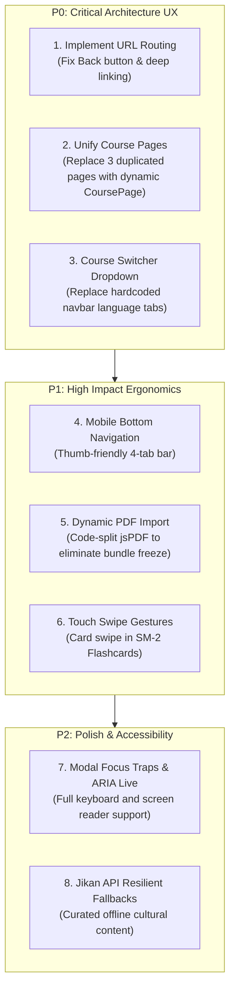

# Lexilume — Comprehensive UX & Usability Audit

> **Document:** `docs/redesign/03_UX_PROBLEMS.md`  
> **Status:** Completed Usability Audit  
> **Target Application:** Lexilume (`https://lexi.monster`)  
> **Repository:** `VINODH0101/language-learning`  
> **Execution Date:** October 2026  

---

## 1. Executive Summary

This document evaluates the user experience, navigation patterns, responsive design, accessibility, and visual ergonomics across Lexilume. While the application possesses a cohesive aesthetic following the design system tokens, critical architectural UX deficiencies impede its usability, scalability, and mobile experience.

---

## 2. Navigation & Routing Deficiencies

### 2.1 State-Based "Tabs" vs. True URL Routing

*Finding Tag:* `[Confirmed from source code: frontend/src/App.tsx#L55-L160]`

1. **Browser Back/Forward Button Breakage:**
   - Because `App.tsx` controls views using `useState<string>('dashboard')`, navigating between pages does not push entries to the browser's history stack.
   - When a user clicks the browser "Back" button while inside a lesson or the vocabulary manager, the browser navigates away from Lexilume entirely rather than returning to the previous view.
2. **Page Refresh Resets State:**
   - Refreshing the browser (`F5` or `Ctrl+R`) immediately resets the view back to the `'dashboard'` tab. Any in-progress lesson or filtered vocabulary search is lost.
3. **No Deep-Linking or Social Sharing:**
   - Users cannot share links to specific lessons, vocabulary items, or cultural articles (e.g., `lexi.monster/learn/pt/lesson-3` or `lexi.monster/culture/carnaval`).
   - All links resolve to the bare root URL `/`.

### 2.2 Navigation Bar Inability to Scale to 13 Languages

*Finding Tag:* `[Confirmed from source code: frontend/src/components/common/Navigation.tsx#L120-L160]`

1. **Hardcoded Language Tabs:**
   - The top navigation bar currently renders dedicated buttons for each supported language track:
     ```tsx
     // Navigation.tsx
     <button onClick={() => onTabChange('portuguese')}>Portuguese</button>
     <button onClick={() => onTabChange('spanish')}>Spanish</button>
     <button onClick={() => onTabChange('english')}>English</button>
     ```
   - Adding the required 10 new languages (`French`, `German`, `Italian`, `Japanese`, `Korean`, `Russian`, `Dutch`, `Mandarin Chinese`, `Turkish`, `Tamil`) will result in **13 language buttons**.
   - On a standard 1280px or 1440px desktop display, 13 buttons plus the utility buttons (`Vocabulary`, `Practice`, `Progress`, `Culture`, `Translate`, `Settings`) will immediately overflow the header, wrap onto multiple lines, and break the UI layout.
2. **Recommendation:**
   - Replace language buttons in the top navbar with a single **Active Course Dropdown / Switcher** (e.g., displaying the active flag and language name, with a modal or dropdown to switch or enroll in courses).

---

## 3. Lesson Experience & Cognitive Flow

### 3.1 3-Way Language Track Duplication

*Finding Tag:* `[Confirmed from source code: PortuguesePage.tsx, SpanishPage.tsx, EnglishPage.tsx]`

1. **Inconsistent State Across Languages:**
   - Because each language page is an independent 332-line component, state logic is duplicated across all three.
   - For example, if a bug fix is applied to how the placement test modal opens in `PortuguesePage.tsx`, it must be manually ported to `SpanishPage.tsx` and `EnglishPage.tsx`.
2. **Cognitive Discontinuity:**
   - The interface treats Portuguese, Spanish, and English as separate applications rather than unified courses within a single platform.
   - Active lesson progress, active unit accordion states, and filters do not share a common controller.

### 3.2 Diagnostic Placement Test UX

*Finding Tag:* `[Confirmed from source code: PlacementTestModal.tsx]`

1. **Fixed Question Order & Repetition:**
   - The placement test currently relies on a static pool of questions. Users taking the diagnostic a second time encounter identical questions in identical sequences.
2. **Lack of Language Parity:**
   - The Portuguese diagnostic is the most mature, while other languages have thinner question banks.
   - Diagnostic tests do not currently offer audio-based listening comprehension questions, placing users solely on reading and vocabulary recall.

---

## 4. Performance & Client UX Bottlenecks

### 4.1 Blocking PDF Study Pack Export

*Finding Tag:* `[Confirmed by an executable test: vocabulary.test.ts]`

1. **Client-Side Freezing:**
   - `pdfService.ts` leverages `jspdf` and `html2canvas` directly on the browser main thread.
   - When generating study packs with >100 vocabulary words, the synchronous DOM rendering and canvas rasterization blocks the React render loop for 2 to 4 seconds, resulting in a noticeable UI freeze on lower-powered mobile devices.
2. **Bundle Bloat:**
   - Importing `jspdf` into the main client bundle adds over 400 kB of uncompressed JavaScript that every user downloads on initial page load, even if they never export a PDF.
3. **Recommendation:**
   - Dynamically import `pdfService.ts` via `import()` when the user clicks the "Download PDF" button, and use a background Web Worker or progressive chunked generation to prevent UI thread lockup.

### 4.2 Jikan Anime/Manga API Degradation

*Finding Tag:* `[Confirmed by an executable test: verify_connections.py stdout]`

1. **Frequent Timeouts & 429 Errors:**
   - In `CultureExplorePage.tsx`, the Japanese culture section calls Jikan API.
   - Connection checks regularly report: `[OFFLINE] Jikan Anime/Manga API: <urlopen error [Errno 101] Network is unreachable>` or rate-limit HTTP 429 errors.
2. **Lack of Friendly Fallback UI:**
   - When Jikan fails, the Japanese anime/manga search section shows a generic error or empty state, leaving the user confused.
   - A curated offline database of popular cultural topics should serve as the primary source, with Jikan treated as an optional enhancement.

---

## 5. Mobile Responsiveness & Touch Ergonomics

### 5.1 Mobile Navigation

*Finding Tag:* `[Confirmed from source code: Navigation.tsx]`

1. **Hamburger Menu Depth:**
   - On screens under `768px` (`md`), navigation collapses into a slide-over hamburger drawer.
   - The drawer contains 11+ vertical options. Tapping a course closes the menu but does not provide bottom navigation for quick switching during active study.
2. **Missing Bottom App Bar:**
   - Modern mobile educational apps (Duolingo, Babbel, Coursera) utilize a fixed bottom navigation bar (Home, Learn, Practice, Profile) for thumb reachability.
   - Lexilume currently forces users to stretch to the top-right corner to open the hamburger menu on every navigation event.

### 5.2 Flashcard Touch Gestures

*Finding Tag:* `[Confirmed from source code: FlashcardDeck.tsx]`

1. **Click-Only Interactions:**
   - `FlashcardDeck.tsx` and `PracticeFlashcards.tsx` rely exclusively on click events to flip cards and rate SM-2 recall (`0` through `5`).
   - Swipe gestures (swipe left for lapse / `0`, swipe right for recall / `5`) are not implemented, making mobile one-handed review awkward.

---

## 6. Accessibility (a11y) & Visual Ergonomics

| Feature / Area | Current Status | Defect Description | Recommendation |
| :--- | :--- | :--- | :--- |
| **Keyboard Navigation** | Partial | Modal dialogs (`PlacementTestModal`, `AuthModal`) do not fully trap focus; tab key cycles out into background elements. | Implement focus trap (`aria-modal="true"` with active focus containment). |
| **Screen Reader Landmarks** | Partial | `<main>`, `<nav>`, `<aside>` landmarks exist, but dynamic exercise feedback lacks `aria-live="polite"` regions. | Add `aria-live="polite"` to correct/incorrect exercise feedback banners. |
| **Audio Playback Feedback** | Tested | Audio buttons play Web Speech audio, but do not provide visual captions or animated wave indicators while speaking. | Display brief highlighted transcript while speech synthesis is active. |
| **High Contrast Mode** | Untested | Dark mode is supported via Tailwind `dark:` classes, but high-contrast border definition between nested cards is subtle. | Increase border contrast on interactive cards in dark mode (`border-neutral-700`). |

---

## 7. Usability Priorities Summary


