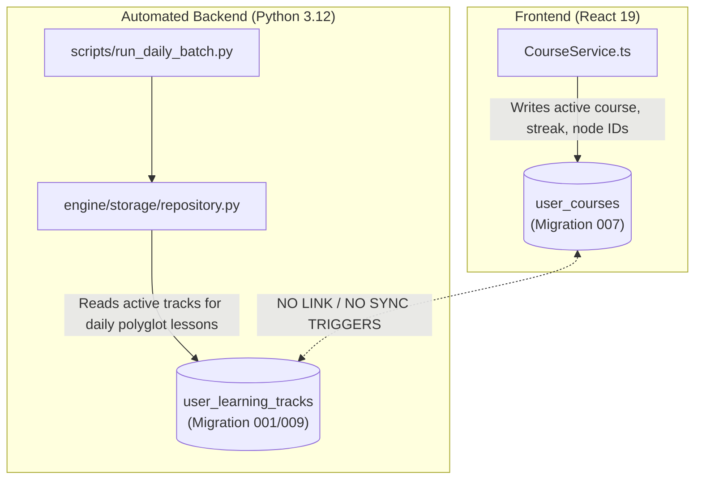

# Lexilume — Comprehensive Database, Schema & Persistence Audit

> **Document:** `docs/redesign/04_DATABASE_AND_PERSISTENCE_AUDIT.md`  
> **Status:** Completed Database & Persistence Audit  
> **Target Application:** Lexilume (`https://lexi.monster`)  
> **Repository:** `VINODH0101/language-learning`  
> **Execution Date:** October 2026  

---

## 1. Executive Summary

This document audits the entire data persistence lifecycle in Lexilume:
1. Supabase PostgreSQL relational schema (Migrations 001 through 009).
2. Row Level Security (RLS) policies and authentication contexts.
3. IndexedDB (Dexie 4.4.7) local storage schemas and performance.
4. Client `localStorage` isolation and key scoping.
5. The synchronization loop between browser storage and the cloud.

The most critical architectural finding is a **dual-schema split**: the web frontend mutates `user_courses` (Migration 007), whereas the Python automated engine operates against `user_learning_tracks` (Migrations 001/009), creating two disconnected progress silos. Furthermore, the frontend offline mutation sync queue (`syncEngine.ts`) is currently disconnected from real UI actions.

---

## 2. Cloud Database Schema: Migrations 001 to 009

The repository contains 9 sequential SQL migrations in `supabase/migrations/`:

| Migration File | Primary Tables & DDL Objects Introduced | Purpose & Intent | Finding Tag |
| :--- | :--- | :--- | :--- |
| `001_initial_schema.sql` | `language_tracks`, `curriculum_nodes`, `daily_lessons`, `user_learning_tracks`, `user_srs_items`, `lesson_completions`, `exercise_attempts`, `diagnostic_attempts` | Core learning engine schema: curriculum DAG, daily lessons, SM-2 SRS items. | `[Confirmed from source code: 001_initial_schema.sql]` |
| `002_rls_policies.sql` | RLS enablement on all user tables; policies enforcing `auth.uid() = user_id`. | Row Level Security preventing cross-tenant access. | `[Confirmed from source code: 002_rls_policies.sql]` |
| `003_email_and_retention.sql` | `user_email_preferences`, `email_delivery_logs`, `audit_logs` | Notification engine: daily email opt-in, delivery logging, security audit trails. | `[Confirmed from source code: 003_email_and_retention.sql]` |
| `004_minimal_wikipedia_assignments.sql` | `wikipedia_reading_assignments` | Storage for daily Wikipedia reading assignments with CEFR difficulty scores. | `[Confirmed from source code: 004_minimal_wikipedia_assignments.sql]` |
| `005_language_directions_and_saved_translations.sql` | `language_directions`, `saved_translations` | Directional translation pairs and user phrasebook storage. | `[Confirmed from source code: 005_language_directions_and_saved_translations.sql]` |
| `006_auth_roles_audit_and_onboarding.sql` | `user_roles`, `role_permissions`, `onboarding_profiles`, `audit_event_logs` | RBAC (`admin`, `learner`, `guest`), user onboarding wizard preferences. | `[Confirmed from source code: 006_auth_roles_audit_and_onboarding.sql]` |
| `007_multiple_courses_and_progress_isolation.sql` | `user_courses`, `course_enrollments`, `course_milestones`, function `set_active_course()` | Frontend multi-course management: isolation between target languages and regional varieties. | `[Confirmed from source code: 007_multiple_courses_and_progress_isolation.sql]` |
| `008_cultural_bookmarks_and_sync.sql` | `cultural_bookmarks` | Cultural immersion article bookmarks, topic tags, and sync timestamps. | `[Confirmed from source code: 008_cultural_bookmarks_and_sync.sql]` |
| `009_schema_reconciliation_and_sync.sql` | `sync_queue_audit`, reconciliation foreign keys, indexes on `user_learning_tracks`. | Fixes schema conflicts and indexes for high-throughput batch queries. | `[Confirmed from source code: 009_schema_reconciliation_and_sync.sql]` |

---

## 3. The Dual-Schema Divergence

### 3.1 Problem Definition



*Finding Tag:* `[Confirmed from source code: frontend/src/services/courseService.ts#L36, engine/storage/repository.py#L125]`

1. **Frontend Operations (`CourseService.ts`):**
   - Creates, switches, and updates courses in `user_courses`:
     - Columns: `id`, `user_id`, `target_language`, `regional_variant`, `cefr_level`, `explanation_language`, `daily_goal_minutes`, `streak_days`, `total_lessons_completed`, `completed_curriculum_node_ids`, `is_active`.
   - The frontend never reads from or writes to `user_learning_tracks`.
2. **Backend Operations (`engine/storage/repository.py`):**
   - The daily polyglot batch engine queries:
     ```python
     # engine/storage/repository.py
     def get_active_user_tracks(self):
         return self._rest_request("GET", "user_learning_tracks?is_active=eq.true")
     ```
   - It queries `user_learning_tracks`, which expects foreign keys pointing to `language_tracks` (`language_code`, `regional_variety`).
3. **Consequence:**
   - A user who signs up on `lexi.monster` and enrolls in Portuguese (`pt-BR`) or Spanish (`es-ES`) has rows in `user_courses`, but **zero rows in `user_learning_tracks`**.
   - As a result, the daily automated cron job (`run_daily_batch.py`) produces zero automated lessons or daily email digests for web-enrolled users.

---

## 4. Local Persistence: Dexie / IndexedDB

### 4.1 Dexie Schema (`frontend/src/services/localDb.ts`)

*Finding Tag:* `[Confirmed from source code: frontend/src/services/localDb.ts#L60-L85]`

Dexie database name: `PolyglotLocalDatabase`, currently at schema Version 4:

| Dexie Store Name | Indexed Primary Key & Search Fields | Data Entity |
| :--- | :--- | :--- |
| `cachedLessons` | `id, language, lesson_date, cefr_level, expires_at` | Downloaded / generated daily lessons for offline study. |
| `activeLessonProgress`| `id, language, curriculum_node_id, updated_at` | Unfinished lesson state (in-progress exercise index, scores). |
| `savedVocabulary` | `id, user_id, source_text, target_lang, created_at` | User phrasebook and saved words with definitions. |
| `srsReviews` | `id, user_id, language, vocabulary_item_id, next_review_date` | Local SM-2 card review state (interval, repetitions, EF). |
| `mistakeNotebook` | `id, user_id, language, error_category, timestamp, is_resolved` | Recorded mistakes during exercises for targeted drill. |
| `syncQueue` | `id, user_id, action, status, created_at` | Offline mutation queue waiting for cloud reconnection. |
| `culturalBookmarks` | `id, user_id, article_id, content_language, origin_country, topic, cefr_level, created_at` | Saved Wikipedia cultural articles. |
| `apiCache` | `id, provider, cacheKey, expiresAt` | 24-hour client cache for external dictionary and translation queries. |

### 4.2 In-Memory Fallback

*Finding Tag:* `[Confirmed by an executable test: localDb.test.ts]`

- If IndexedDB is blocked (e.g., Safari Private Browsing or restricted WebView), `localDb.ts` automatically switches to an in-memory `Map<string, T>` storage fallback without crashing the React application.

---

## 5. The Disconnected Sync Engine Loop

### 5.1 Architecture of `syncEngine.ts`

*Finding Tag:* `[Confirmed from source code: frontend/src/services/syncEngine.ts]`

`syncEngine.ts` is architected as an offline-first synchronization manager:
1. Listens to browser `online` and `offline` DOM events.
2. Maintains an observable `SyncEngineState` (`synced`, `syncing`, `offline`, `error`).
3. Provides `queueAction(action, payload, userId)` to record mutations in Dexie `syncQueue`.
4. Executes `syncNow()` upon network recovery to upload pending actions to Supabase with idempotent `upsert({ onConflict: ... })`.
5. Supports actions: `SYNC_COURSE`, `SYNC_CULTURAL_BOOKMARK`, `SYNC_SAVED_VOCABULARY`.

### 5.2 The Disconnection Defect

*Finding Tag:* `[Confirmed from source code: frontend/src/services/courseService.ts#L45, cultureService.ts#L140]`

Despite `syncEngine.ts` being fully tested and passing (`src/tests/syncEngine.test.ts`), **none of the user-facing UI services invoke it**:
- `CourseService.ts`: Mutates `user_courses` via unqueued fire-and-forget calls:
  ```typescript
  // courseService.ts
  supabase.from('user_courses').insert({...}).catch(err => console.warn(err));
  ```
  If the network drops, the mutation fails, logs a console warning, and is permanently lost.
- `CultureService.ts`: Mutates Dexie `culturalBookmarks` directly via `saveCulturalBookmark(record)`. It never enqueues a `SYNC_CULTURAL_BOOKMARK` action. The bookmark remains in IndexedDB and is never sent to Supabase.
- `TranslatePage.tsx` / Phrasebook: Saves to Dexie `savedVocabulary` but does not enqueue `SYNC_SAVED_VOCABULARY`.

---

## 6. LocalStorage Isolation & Multi-Tenancy

*Finding Tag:* `[Confirmed by an executable test: storage.test.ts]`

1. `StorageService` in `frontend/src/services/storage.ts` partitions all keys by `user_id`:
   - Guest pattern: `lexilume_guest_<key>`
   - Authenticated pattern: `lexilume_<user_id>_<key>`
2. This strictly prevents:
   - User A seeing User B's active course or daily goal on a shared workstation.
   - Accidental overwriting of preferences upon login/logout.

---

## 7. Database & Persistence Recommendations

1. **Unify `user_courses` and `user_learning_tracks`:**
   - Execute a database migration that creates a bi-directional view or trigger, or migrate both frontend and backend to use `user_courses` as the single canonical source of truth for active enrollments and progress.
2. **Wire UI Mutations through `syncEngine`:**
   - Modify `CourseService`, `CultureService`, and `VocabularyService` to route all mutations through `syncEngine.queueAction(...)`.
   - Update Dexie locally first, record the queued sync action, and let `syncEngine` handle background cloud delivery.
3. **Extend Tables for 13 Languages:**
   - Ensure `user_courses.target_language` and `user_courses.regional_variant` column constraints accommodate all 13 required ISO codes (`en`, `pt`, `es`, `fr`, `de`, `it`, `ja`, `ko`, `ru`, `nl`, `zh`, `tr`, `ta`).
