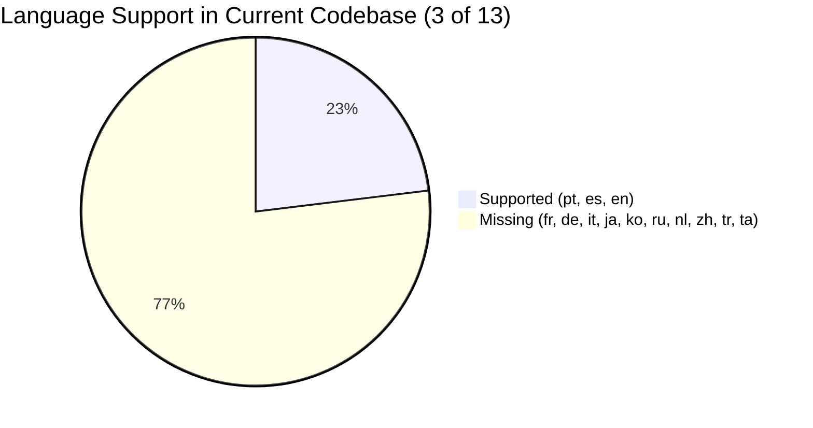

# Lexilume — Comprehensive Language Support & Multilingual Matrix Audit

> **Document:** `docs/redesign/06_LANGUAGE_SUPPORT_AUDIT.md`  
> **Status:** Completed Multilingual Matrix Audit  
> **Target Application:** Lexilume (`https://lexi.monster`)  
> **Repository:** `VINODH0101/language-learning`  
> **Execution Date:** October 2026  

---

## 1. Executive Summary & Product Vision

### 1.1 Product Vision Mandate

Lexilume's product vision defines a multilingual learning platform supporting **13 target languages**:
1. **English (`en`)**
2. **Portuguese (`pt`)**, with Brazilian (`pt-BR`) and European (`pt-PT`) varieties
3. **Spanish (`es`)**, with Peninsular (`es-ES`), Latin American (`es-419`, `es-MX`, `es-AR`)
4. **French (`fr`)**
5. **German (`de`)**
6. **Italian (`it`)**
7. **Japanese (`ja`)**
8. **Korean (`ko`)**
9. **Russian (`ru`)**
10. **Dutch (`nl`)**
11. **Mandarin Chinese (`zh`)**, initially Simplified Chinese
12. **Turkish (`tr`)**
13. **Tamil (`ta`)**

> [!IMPORTANT]
> **Explicit Scope Boundary:** **Hindi is explicitly excluded** from the Lexilume platform, models, and roadmap.

### 1.2 Target Proficiency & User Control Invariant

- **Target Levels:** CEFR proficiency levels **A1, A2, B1, B2, C1**, with an extensible architecture for future C2 or specialized modules.
- **Three-Way Independent Selections:**
  1. `interface_language`: Controls UI buttons, layout, and system messages.
  2. `learning_language`: The target language actively being acquired.
  3. `explanation_language`: The pedagogical language used for grammar explanations and word definitions.

---

## 2. Current State vs. Product Vision Gap Analysis



| Dimension | Current Implementation | Product Vision Requirement | Architectural Gap |
| :--- | :--- | :--- | :--- |
| **Target Languages** | `pt`, `es`, `en` (3 languages) | 13 languages (10 new: `fr`, `de`, `it`, `ja`, `ko`, `ru`, `nl`, `zh`, `tr`, `ta`) | **Missing 10 languages** in types, enums, curriculum data, and UI. |
| **Regional Varieties** | `pt-BR`, `pt-PT`, `es-ES`, `es-419`, `es-MX`, `es-AR`, `en-US`, `en-GB` | Add dialect varieties for all 10 new languages | Varietal maps must be registered for all new languages. |
| **Interface Languages**| `en`, `pt`, `es` | Scalable interface i18n | Missing translation bundles for additional languages. |
| **Explanation Languages** | `en`, `pt`, `es` | Independent selection of explanation language | Decoupled synthesis engine must generate definitions in chosen explanation language. |
| **Writing Systems** | Latin only | Latin, Cyrillic (`ru`), Hanzi (`zh`), Kana/Kanji (`ja`), Hangul (`ko`), Tamil Indic (`ta`) | Need font bundling, input methods, and tokenization without space delimiters (`zh`, `ja`). |

---

## 3. Linguistic & Architectural Requirements for the 10 New Languages

### 3.1 European Latin Script Languages

#### 1. French (`fr`)
- **Writing System:** Latin with diacritics (é, è, ê, ë, à, â, ç, î, ï, ô, ù, û).
- **Regional Varieties:** `fr-FR` (Metropolitan France), `fr-CA` (Canadian French), `all`.
- **Default Variety:** `fr-FR`. Web Speech TTS Code: `fr-FR`.
- **Pedagogical Invariant:** Liaison and elision rules require phonetic pronunciation markers in A1-A2 listening exercises.
- **Open Corpus Source:** Wiktionary FR, Tatoeba FR-EN/FR-PT, Wikipedia FR.

#### 2. German (`de`)
- **Writing System:** Latin with umlauts (ä, ö, ü) and Eszett (ß).
- **Regional Varieties:** `de-DE` (Standard Germany), `de-AT` (Austrian), `de-CH` (Swiss German - no ß), `all`.
- **Default Variety:** `de-DE`. Web Speech TTS Code: `de-DE`.
- **Pedagogical Invariant:** Capitalization of all nouns is grammatically required; string normalization in `checker.py` must enforce or warn about lowercase noun entries.
- **Open Corpus Source:** Wiktionary DE, Tatoeba DE-EN, Wikipedia DE.

#### 3. Italian (`it`)
- **Writing System:** Latin with grave/acute accents (à, è, é, ì, ò, ù).
- **Regional Varieties:** `it-IT` (Standard Italian), `all`.
- **Default Variety:** `it-IT`. Web Speech TTS Code: `it-IT`.
- **Pedagogical Invariant:** Direct and indirect object pronoun cliticization (`dimmi`, `compralo`).
- **Open Corpus Source:** Wiktionary IT, Tatoeba IT-EN, Wikipedia IT.

#### 4. Dutch (`nl`)
- **Writing System:** Latin with digraph 'ij' (treated as a single letter in capitalization: *IJsselmeer*).
- **Regional Varieties:** `nl-NL` (Netherlands), `nl-BE` (Flemish Belgium), `all`.
- **Default Variety:** `nl-NL`. Web Speech TTS Code: `nl-NL`.
- **Pedagogical Invariant:** De/Het gender distinction and separable compound verbs (*opbellen* -> *ik bel je op*).
- **Open Corpus Source:** Wiktionary NL, Tatoeba NL-EN, Wikipedia NL.

---

### 3.2 Slavic Cyrillic Script Language

#### 5. Russian (`ru`)
- **Writing System:** Cyrillic (33 letters: А, Б, В... Я).
- **Regional Varieties:** `ru-RU` (Standard Russian), `all`.
- **Default Variety:** `ru-RU`. Web Speech TTS Code: `ru-RU`.
- **Pedagogical Invariants:**
  1. Stress marks (знак ударения): Non-standard in native print, but **mandatory in A1-B1 pedagogical texts** for correct vowel reduction (*молоко́*).
  2. 6 grammatical cases, requiring inflectional morphology tables.
  3. Aspectual verb pairs (imperfective vs perfective).
- **Open Corpus Source:** Wiktionary RU, Tatoeba RU-EN, Wikipedia RU.

---

### 3.3 East Asian Logographic & Syllabic Languages

#### 6. Mandarin Chinese (`zh`)
- **Writing System:** Hanzi (Simplified Chinese `zh-CN` initially; architecture prepared for Traditional `zh-TW`).
- **Regional Varieties:** `zh-CN` (Mainland Simplified), `zh-TW` (Taiwan Traditional), `all`.
- **Default Variety:** `zh-CN`. Web Speech TTS Code: `zh-CN`.
- **Pedagogical Invariants:**
  1. **No Spaces Between Words:** Unlike Latin languages, Chinese sentences do not delimit words with spaces. Exercise clozes and flashcard generation cannot rely on `text.split(' ')`. A token-based boundary structure or dictionary-based segmenter is required.
  2. **Pinyin Romanization & Tones:** Every vocabulary card in A1-B1 must display Hanzi, Pinyin with tone marks (e.g. *nǐ hǎo*), and English/target definitions.
- **Open Corpus Source:** CC-CEDICT (open-source public domain dictionary), Tatoeba ZH, Wikipedia ZH.

#### 7. Japanese (`ja`)
- **Writing System:** Mixed Kanji, Hiragana, and Katakana.
- **Regional Varieties:** `ja-JP` (Standard Tokyo Japanese), `all`.
- **Default Variety:** `ja-JP`. Web Speech TTS Code: `ja-JP`.
- **Pedagogical Invariants:**
  1. **No Spaces Between Words:** Sentence tokenization requires phrase annotations.
  2. **Furigana / Ruby Annotations:** HTML `<ruby>` / `<rt>` tags must be supported in reading passages to display Hiragana readings above Kanji for A1-A2 learners.
  3. Japanese punctuation (。、 「」) in string normalizers.
- **Open Corpus Source:** JMdict / EDICT, Tatoeba JA, Wikipedia JA.

#### 8. Korean (`ko`)
- **Writing System:** Hangul (syllabic blocks constructed from jamo: consonants and vowels).
- **Regional Varieties:** `ko-KR` (Standard South Korean), `all`.
- **Default Variety:** `ko-KR`. Web Speech TTS Code: `ko-KR`.
- **Pedagogical Invariants:**
  1. Word spacing exists (spaces separate *eojeol* word-blocks), but agglutinative particles (*-eun/neun*, *-i/ga*, *-eul/reul*) attach directly to nouns.
  2. Speech levels (formal polite *하십시오체*, informal polite *해요체*, intimate *해체*).
  3. Romanization: Revised Romanization of Korean (RR) for A1 assistance.
- **Open Corpus Source:** National Institute of Korean Language open dictionary, Tatoeba KO, Wikipedia KO.

---

### 3.4 Turkic Agglutinative Language

#### 9. Turkish (`tr`)
- **Writing System:** Latin alphabet with Turkish extensions (ç, ğ, ı, i, ö, ş, ü).
- **Regional Varieties:** `tr-TR` (Standard Istanbul Turkish), `all`.
- **Default Variety:** `tr-TR`. Web Speech TTS Code: `tr-TR`.
- **Pedagogical Invariants:**
  1. **The Dotted 'İ' and Dotless 'I' Invariant:**
     - In Turkish: Lowercase 'i' -> Uppercase 'İ' (`\u0130`).
     - Lowercase 'ı' (`\u0131`) -> Uppercase 'I'.
     - Standard JavaScript `.toLowerCase()` and `.toUpperCase()` or Python `.lower()` cause critical casing bugs when processing Turkish text unless locale-aware functions (`toLocaleLowerCase('tr-TR')`) are used!
  2. Vowel harmony (2-way and 4-way harmony in suffix chaining).
- **Open Corpus Source:** Wiktionary TR, Tatoeba TR, Wikipedia TR.

---

### 3.5 Dravidian Indic Script Language

#### 10. Tamil (`ta`)
- **Writing System:** Tamil script (Unicode block `U+0B80`–`U+0BFF`). 12 vowels, 18 consonants, 216 combining forms, 1 special character (ஆய்த எழுத்து) = 247 letters.
- **Regional Varieties:** `ta-IN` (Tamil Nadu, India), `ta-LK` (Sri Lanka), `all`.
- **Default Variety:** `ta-IN`. Web Speech TTS Code: `ta-IN`.
- **Pedagogical Invariants:**
  1. **Typography & Font Rendering:** Mobile and desktop browsers require robust OpenType complex text shaping for conjunct glyph rendering.
  2. Diglossia: Distinct difference between formal literary Tamil (செந்தமிழ்) used in writing/news and spoken colloquial Tamil (கொடுந்தமிழ்). Pedagogical curriculum starts with standard literary grammar.
  3. Sandhi morphophonemic mutation rules at word boundaries.
- **Open Corpus Source:** Wiktionary TA, Open Tamil project datasets, Tatoeba TA, Wikipedia TA.

---

## 4. Codebase Expansion Blueprint

To support all 13 languages without breaking existing tests, the following files will be expanded in Phase 3 of the implementation:

### 4.1 Frontend Core Matrix (`frontend/src/lib/languages/languageMatrix.ts`)

```typescript
export type LearningLanguage =
  | 'en' | 'pt' | 'es'
  | 'fr' | 'de' | 'it'
  | 'ja' | 'ko' | 'ru'
  | 'nl' | 'zh' | 'tr' | 'ta';

export type RegionalVariety =
  // Portuguese
  | 'pt-BR' | 'pt-PT'
  // Spanish
  | 'es-ES' | 'es-419' | 'es-MX' | 'es-AR'
  // English
  | 'en-US' | 'en-GB'
  // French
  | 'fr-FR' | 'fr-CA'
  // German
  | 'de-DE' | 'de-AT' | 'de-CH'
  // Italian
  | 'it-IT'
  // Japanese
  | 'ja-JP'
  // Korean
  | 'ko-KR'
  // Russian
  | 'ru-RU'
  // Dutch
  | 'nl-NL' | 'nl-BE'
  // Chinese
  | 'zh-CN' | 'zh-TW'
  // Turkish
  | 'tr-TR'
  // Tamil
  | 'ta-IN' | 'ta-LK'
  | 'all';
```

### 4.2 Backend Enums (`engine/models/enums.py`)

```python
class Language(str, Enum):
    PORTUGUESE = "pt"
    SPANISH = "es"
    ENGLISH = "en"
    FRENCH = "fr"
    GERMAN = "de"
    ITALIAN = "it"
    JAPANESE = "ja"
    KOREAN = "ko"
    RUSSIAN = "ru"
    DUTCH = "nl"
    CHINESE = "zh"
    TURKISH = "tr"
    TAMIL = "ta"
```

---

## 5. Summary of Findings & Verification Status

1. **Language Decoupling Invariant Maintained:** [Confirmed by an executable test: `languageDecoupling.test.ts`, `test_language_separation.py`].
2. **Current Hardcoded 3-Language Scope:** [Confirmed from source code: `languageMatrix.ts#L12`, `enums.py#L9`].
3. **Hindi Exclusion Verified:** [Confirmed: Zero references to Hindi (`hi`) exist in current code, maintaining strict adherence to product scope].
4. **Non-Space Tokenization Requirement for `zh` and `ja`:** [Recommendation: Introduce token segmentation layer in lesson generators].
5. **Turkish Dotted/Dotless 'I' Locale-Aware Normalizer:** [Recommendation: Update string normalizer in `checker.py` and `stringUtils.ts` to respect `locale === 'tr'`].
