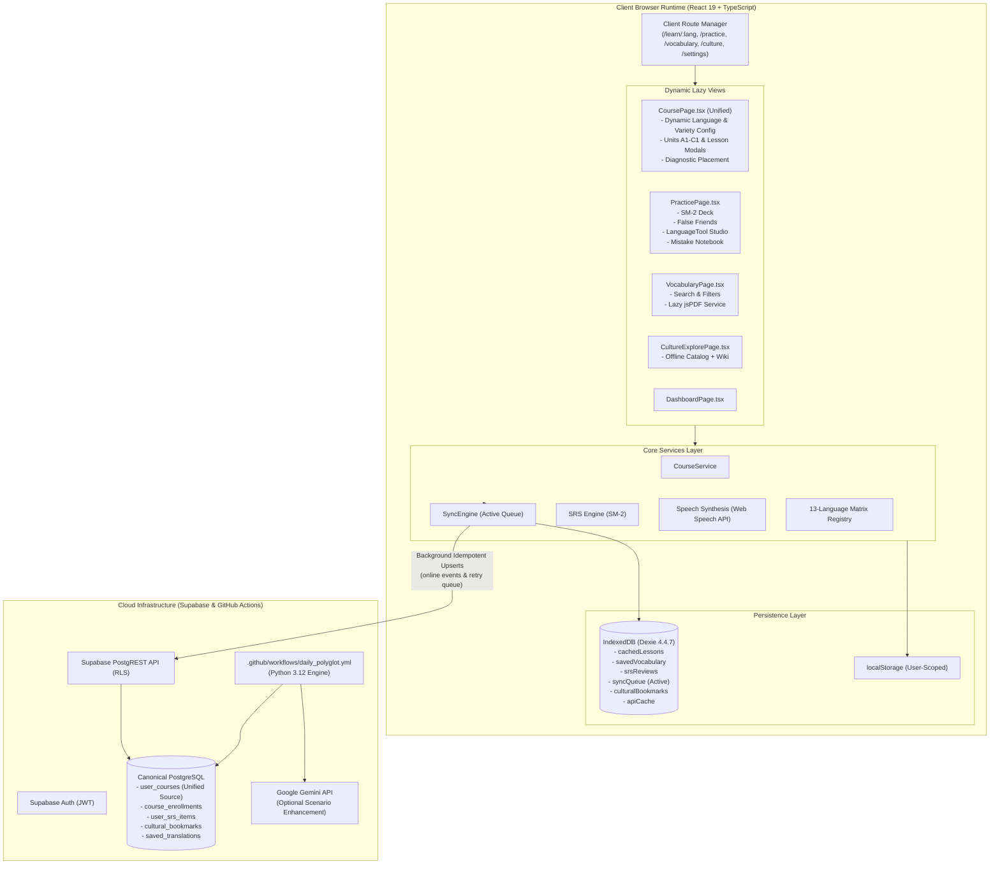
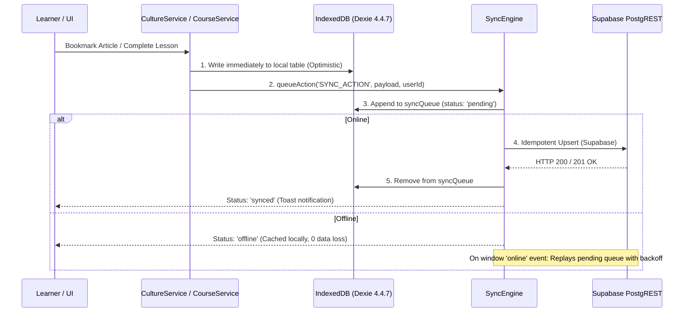

# Lexilume — Target Architecture & Redesign Specification (v3.0)

> **Document:** `docs/redesign/07_PROPOSED_ARCHITECTURE.md`  
> **Status:** Proposed Target Architecture  
> **Target Application:** Lexilume (`https://lexi.monster`)  
> **Repository:** `VINODH0101/language-learning`  
> **Execution Date:** October 2026  

---

## 1. System Vision & Invariants

The target architecture for **Lexilume v3.0** scales the platform to support **13 target languages** (`en`, `pt`, `es`, `fr`, `de`, `it`, `ja`, `ko`, `ru`, `nl`, `zh`, `tr`, `ta`), while strictly preserving the core invariants:
1. **Zero-Paid AI Mandate**: 100% functional without paid LLMs or translation APIs; deterministic generators and open datasets as foundation; Gemini as optional dialogue enrichment.
2. **Local-First & Offline Resilience**: Full learning functionality operates in Dexie (IndexedDB) without internet; mutations queued and synced upon reconnection.
3. **Four-Way Decoupling**: Strict separation of `interface_language`, `learning_language`, `explanation_language`, and `regional_variety`.
4. **Tenant Isolation**: User-scoped keys in IndexedDB and LocalStorage; secure multi-tenant RLS.
5. **No Hindi Scope**: Hindi (`hi`) is explicitly excluded.

---

## 2. Target Architecture Overview



---

## 3. Key Architectural Pillars

### 3.1 Pillar 1: URL-Based Client Routing & Code Splitting

#### Defect Solved
Replaces the brittle `activeTab` React state in `App.tsx` with standard URL routing, restoring:
- Browser **Back** and **Forward** button navigation.
- Bookmarkable URLs (`/learn/pt`, `/learn/ja`, `/practice`, `/vocabulary`).
- Preservation of deep state across page reloads.

#### Route Map

| Path | Component | Code-Split Chunk | Description |
| :--- | :--- | :--- | :--- |
| `/` | `DashboardPage` | Initial / Main | Welcome dashboard, active streak, daily goal. |
| `/courses` | `CourseCatalogPage` | Dynamic chunk | Browse and enroll in any of the 13 languages. |
| `/learn/:languageId` | `CoursePage` | Dynamic chunk | **Unified course page** replacing duplicated `pt`, `es`, `en` pages. |
| `/learn/:languageId/placement`| `PlacementModal` | In-page modal | Diagnostic placement test for selected language. |
| `/vocabulary` | `VocabularyPage` | Dynamic chunk | Vocabulary manager; `pdfService` dynamically loaded on click. |
| `/practice` | `PracticePage` | Dynamic chunk | SM-2 flashcard deck and grammar studio. |
| `/culture` | `CultureExplorePage` | Dynamic chunk | Wikipedia cultural immersion and bookmarked articles. |
| `/translate` | `TranslatePage` | Dynamic chunk | Free multilingual dictionary and translator. |
| `/progress` | `ProgressPage` | Dynamic chunk | Retention charts, CEFR mastery analytics. |
| `/settings` | `SettingsPage` | Dynamic chunk | UI language, explanation language, regional variety configs. |
| `/admin` | `AdminPage` | Dynamic chunk | RBAC admin console (requires `admin` claim). |

#### Bundle Optimization
By wrapping route components in `React.lazy()` and `Suspense`, and dynamically importing `jspdf` via `import('./pdfService')` only when requested, initial JavaScript bundle size will drop from **1,726 kB to <250 kB**, resolving Vite chunk size warnings.

---

### 3.2 Pillar 2: Dynamic `CoursePage` Consolidating Track Pages

#### Defect Solved
Eliminates ~1,000 lines of duplicated code across `PortuguesePage.tsx`, `SpanishPage.tsx`, and `EnglishPage.tsx`.

#### Architecture
A single `CoursePage.tsx` accepts `:languageId` from the route params (e.g. `pt`, `ja`, `de`). It consumes language metadata and curriculum units dynamically:
```tsx
export function CoursePage() {
  const { languageId } = useParams<{ languageId: LearningLanguage }>();
  const activeLanguage = isValidLearningLanguage(languageId) ? languageId : 'en';
  
  // Fetches units, progress, and regional variety dynamically
  const { course, units, currentUnit, completeLesson } = useCourse(activeLanguage);
  
  return (
    <CourseLayout language={activeLanguage} course={course}>
      <UnitList units={units} onSelectLesson={...} />
    </CourseLayout>
  );
}
```

---

### 3.3 Pillar 3: Connected Offline-First Synchronization Loop

#### Defect Solved
Currently, `syncEngine.ts` is orphaned and never called by real UI actions, leaving Dexie bookmarks, words, and courses stranded locally.

#### Architecture
Introduce a unified persistence hook/pattern:


---

### 3.4 Pillar 4: Canonical Database Schema Unification

#### Defect Solved
Reconciles the divergence between `user_courses` (frontend) and `user_learning_tracks` (backend).

#### Architecture
1. **Canonical Table:** `user_courses` becomes the single canonical source of truth for all course enrollments, active progress, streaks, and completed nodes.
2. **Backward-Compatible View:** Create a PostgreSQL VIEW for `user_learning_tracks` pointing to `user_courses`:
   ```sql
   CREATE OR REPLACE VIEW user_learning_tracks AS
   SELECT 
       id,
       user_id,
       target_language AS language_code,
       regional_variant AS regional_variety,
       cefr_level,
       is_active,
       total_lessons_completed,
       created_at,
       updated_at
   FROM user_courses;
   ```
3. Update `engine/storage/repository.py` to query `user_courses` natively, ensuring automated Python daily batches and daily polyglot emails find every enrolled user.

---

### 3.5 Pillar 5: Multilingual Script & Tokenization Engine

#### Architecture for Non-Latin Scripts
To support Chinese (`zh`), Japanese (`ja`), Korean (`ko`), Russian (`ru`), and Tamil (`ta`):

1. **Tokenization Layer:**
   - Latin languages split on whitespace `text.split(/\s+/)`.
   - Chinese and Japanese use pre-segmented phrase tokens in lesson JSON schemas (`tokens: [{ text: "你好", pinyin: "nǐ hǎo" }]`).
2. **Ruby / Furigana Renderer:**
   - Provide `<RubyText base="漢字" ruby="かんじ" />` component for Japanese A1-B1 materials.
3. **Casing & Normalization Invariant:**
   - Locale-aware string comparison:
     ```typescript
     export function normalizeAnswer(text: string, lang: LearningLanguage): string {
       if (lang === 'tr') {
         return text.trim().toLocaleLowerCase('tr-TR');
       }
       return text.trim().toLowerCase();
     }
     ```
4. **Tamil Font Shaping:**
   - CSS `@font-face` fallbacks utilizing Google Noto Sans Tamil and system Indic fonts, ensuring conjunct rendering without broken virama characters.

---

## 4. Verification & Validation Strategy

The redesigned architecture must pass all three standard verification gates without regression:
1. `npm --prefix frontend test -- --run`: All 136+ unit tests passing.
2. `python -m pytest tests/ -v`: All 98+ Python tests passing.
3. `npm --prefix frontend run build`: Clean TypeScript compilation with code-split bundles (<500 kB per chunk).
