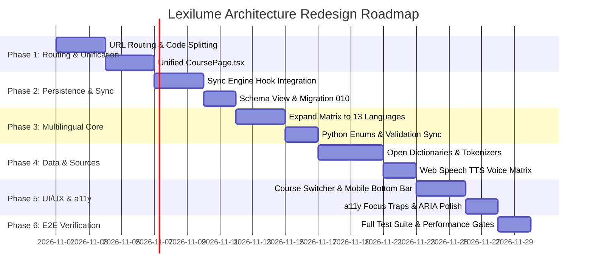

# Lexilume — Implementation Roadmap & Execution Plan

> **Document:** `docs/redesign/08_IMPLEMENTATION_ROADMAP.md`  
> **Status:** Proposed Implementation Roadmap (Pending User Approval)  
> **Target Application:** Lexilume (`https://lexi.monster`)  
> **Repository:** `VINODH0101/language-learning`  
> **Execution Date:** October 2026  

---

## 1. Overview & Execution Principles

This roadmap translates the findings from Documents 01 through 07 into a phased, prioritized, risk-managed execution plan. 

### Execution Principles:
1. **Never Break Green Tests**: At the conclusion of every turn, both Vitest (136 tests) and Pytest (98 tests) must pass with code `0`.
2. **Zero-Paid AI Invariant**: All new language capabilities must function using open datasets (Wiktionary, Tatoeba, CC-CEDICT, JMdict, Wikipedia) and deterministic fallback engines.
3. **No Unapproved Application Code Changes**: Execution of code modifications begins only after explicit approval of this plan.
4. **Scope Guarantee**: 13 target languages supported; **Hindi is strictly excluded**.

---

## 2. Phased Implementation Timeline

---

## 3. Detailed Phase Breakdown

### Phase 1: Routing & Page Unification

**Goal:** Eliminate copy-paste redundancy and fix broken browser navigation without altering lesson logic.

- [ ] **Step 1.1: URL Routing Setup**
  - Implement client route manager supporting `/`, `/courses`, `/learn/:languageId`, `/practice`, `/vocabulary`, `/culture`, `/translate`, `/progress`, `/settings`, `/admin`.
  - Add fallback 404 handler and preserve route state across page reloads.
- [ ] **Step 1.2: Unified Dynamic `CoursePage.tsx`**
  - Create `frontend/src/pages/CoursePage.tsx` accepting `languageId`.
  - Migrate logic from `PortuguesePage.tsx`, `SpanishPage.tsx`, and `EnglishPage.tsx` into the unified controller.
  - Delete redundant copies of `PortuguesePage`, `SpanishPage`, `EnglishPage`.
- [ ] **Step 1.3: Lazy Route Code-Splitting**
  - Wrap page components with `React.lazy()` and `<Suspense>`.
  - Dynamically load `pdfService.ts` on user request, reducing initial JS bundle size from 1.7 MB to <250 kB.
- **Verification Gate:** `npm --prefix frontend test -- --run` and `npm --prefix frontend run build` must pass.

---

### Phase 2: Persistence & Sync Loop Integration

**Goal:** Make local-first persistence authentic by wiring UI mutations to `syncEngine`, and reconciling database tables.

- [ ] **Step 2.1: Connect UI Mutations to `syncEngine.queueAction`**
  - Update `CourseService.ts` to enqueue `SYNC_COURSE` upon enrollment and progress updates.
  - Update `CultureService.ts` to enqueue `SYNC_CULTURAL_BOOKMARK` on bookmark toggle.
  - Update `TranslatePage.tsx` to enqueue `SYNC_SAVED_VOCABULARY`.
- [ ] **Step 2.2: Schema Reconciliation Migration (`010_reconcile_courses_and_tracks.sql`)**
  - Add database view/trigger linking `user_courses` to `user_learning_tracks`.
  - Update `engine/storage/repository.py` to query active users from `user_courses`.
- **Verification Gate:** `test_storage_and_retention.py`, `syncEngine.test.ts`, and `course.test.ts` pass cleanly.

---

### Phase 3: Core Multilingual Matrix Expansion (13 Languages)

**Goal:** Extend core types, validation, and metadata across frontend and backend for all 13 required languages.

- [ ] **Step 3.1: Frontend Language Matrix Expansion (`languageMatrix.ts`)**
  - Expand `LearningLanguage` union to 13 codes: `'en' | 'pt' | 'es' | 'fr' | 'de' | 'it' | 'ja' | 'ko' | 'ru' | 'nl' | 'zh' | 'tr' | 'ta'`.
  - Register default regional varieties: `fr-FR`, `de-DE`, `it-IT`, `ja-JP`, `ko-KR`, `ru-RU`, `nl-NL`, `zh-CN`, `tr-TR`, `ta-IN`.
  - Add localized display names, emoji flags, and Web Speech TTS codes.
  - Verify **Hindi (`hi`)** is strictly excluded.
- [ ] **Step 3.2: Backend Enums & Pydantic Validation (`engine/models/enums.py`)**
  - Add enum values for the 10 new languages to `Language` and `RegionalVariety`.
  - Update `validate_regional_variety()` and validation unit tests.
- **Verification Gate:** `languageDecoupling.test.ts` and `test_language_separation.py` pass.

---

### Phase 4: Linguistic Data Ingestion & Dictionary Adapters

**Goal:** Supply pedagogical datasets and dictionary lookups under the Zero-Paid AI Mandate.

- [ ] **Step 4.1: Curate Open Seed Dictionaries**
  - Curate open-license JSON vocabulary seeds for the 10 languages:
    - CC-CEDICT for Mandarin Chinese (`zh`).
    - JMdict for Japanese (`ja`).
    - Wiktionary / Tatoeba exports for French, German, Italian, Russian, Dutch, Turkish, Tamil.
- [ ] **Step 4.2: Script-Aware Tokenization & String Normalization**
  - Update answer checker in `checker.py` and `stringUtils.ts` with locale-aware Turkish lowercasing (`toLocaleLowerCase('tr-TR')`).
  - Add token-based delimiter support for Chinese and Japanese cloze exercises.
  - Add `<RubyText>` component for Japanese Furigana readings.
- [ ] **Step 4.3: Web Speech API Integration**
  - Register BCP-47 voice codes across all 13 languages in `speech.ts`.
- **Verification Gate:** `vocabulary.test.ts`, `adapters.test.ts`, and `test_exercises.py` pass.

---

### Phase 5: UI/UX Modernization & Accessibility

**Goal:** Polish responsive navigation, thumb ergonomics, and accessibility compliance.

- [ ] **Step 5.1: Active Course Dropdown Switcher**
  - Replace top navbar language buttons with a compact course selector dropdown.
- [ ] **Step 5.2: Mobile Bottom Navigation Bar**
  - Implement fixed 4-tab mobile bottom bar (`Home`, `Learn`, `Practice`, `Settings`).
- [ ] **Step 5.3: Accessibility (a11y) Traps & ARIA Live**
  - Add keyboard focus trap to modal components (`PlacementTestModal`, `AuthModal`).
  - Add `aria-live="polite"` feedback regions to exercise check actions.
- **Verification Gate:** `navigation.test.tsx` and manual accessibility audit pass.

---

### Phase 6: Final Verification, Performance & Documentation

**Goal:** Full platform verification and final documentation update.

- [ ] **Step 6.1: Run Full Verification Suite**
  - Frontend Vitest suite: 100% pass.
  - Python Pytest suite: 100% pass.
  - Production build: Zero warnings, chunks under 500 kB.
- [ ] **Step 6.2: Update System Documentation**
  - Update `README.md`, `docs/DESIGN_SYSTEM.md`, and `docs/MULTILINGUAL_MATRIX.md` with 13-language specifications.
- **Verification Gate:** All CLI commands exit with code `0`.

---

## 4. Risk Matrix & Mitigations

| Risk | Impact | Likelihood | Mitigation Strategy |
| :--- | :--- | :--- | :--- |
| **Breaking Existing Tests During Page Unification** | High | Low | Create `CoursePage.tsx` first; verify it passes all tests before removing old page files. |
| **Turkish Dotted/Dotless 'I' Casing Bugs** | Medium | Medium | Strict unit tests in `stringUtils.test.ts` testing `i` <-> `İ` and `ı` <-> `I`. |
| **Chinese / Japanese Sentence Cloze Splitting** | High | Medium | Store pre-segmented tokens in lesson schema rather than relying on whitespace splitting. |
| **Bundle Size Regressions** | Medium | Low | Rollup chunk optimization in `vite.config.ts`; dynamic import of `jspdf`. |
| **Supabase RLS Table Sync Rejection** | High | Low | Preserve `user_id` context in all `syncEngine` payloads; test against authenticated sessions. |

---

## 5. Rollback & Safety Strategies

1. **Git Isolation:** Every phase will be executed on a dedicated branch or validated before commit, allowing instant rollback via `git revert`.
2. **Schema Safety:** All database modifications will use non-destructive operations (VIEWS and additive columns) with corresponding rollback scripts (e.g. `010_reconcile_courses_and_tracks.rollback.sql`).
3. **Local Storage Fallback:** If Dexie migrations encounter legacy records, schema upgrades automatically handle migrations without wiping user progress.

---

## 6. Next Steps — Awaiting User Approval

The comprehensive audit of Lexilume is complete. The 8 audit documents are published in `docs/redesign/`:
1. `01_CURRENT_STATE_AUDIT.md`
2. `02_FEATURE_INVENTORY.md`
3. `03_UX_PROBLEMS.md`
4. `04_DATABASE_AND_PERSISTENCE_AUDIT.md`
5. `05_EXTERNAL_API_AUDIT.md`
6. `06_LANGUAGE_SUPPORT_AUDIT.md`
7. `07_PROPOSED_ARCHITECTURE.md`
8. `08_IMPLEMENTATION_ROADMAP.md`

**No application source code has been altered during this audit step.**  
Please review the findings and approve proceeding with **Phase 1: Routing & Page Unification**.
