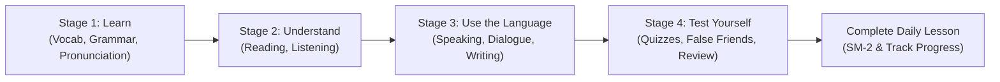

# Lexilume — UI & Learning Experience Redesign Report (Step 7)

> **Document Version:** 1.0.0  
> **Target Audience:** Engineering, Product, UI/UX, QA  
> **Status:** Fully Implemented & Verified  

---

## 1. Executive Summary

In **Step 7**, Lexilume's user interface and daily pedagogical flow were overhauled to provide a clean, modern, responsive, and intuitive experience for language learners across desktop and mobile devices.

The redesign satisfies all core requirements:
1. **Four Primary Destinations:** Restructured top-level navigation to **Home**, **Learn**, **Practice**, and **Progress**. Nested **Discover / Worldwide Culture** as a curated study tool inside Learn.
2. **Top-Right Profile Menu:** Consolidated user profile information, learning track settings, language preferences, guided onboarding trigger, and admin console into a dedicated profile dropdown.
3. **Daily Focus Dashboard ("What should I learn today?"):** Streamlined dashboard centered on immediate action:
   - Primary **Continue Learning** hero card displaying active target language, CEFR badge, today's recommended lesson topic, estimated time, and direct launch CTA.
   - Core metrics row: Real Learning Streak, Daily Goal progress, and Due SRS Vocabulary cards.
   - Clean recent activity feed and dynamic cultural immersion previews filtered by interface language.
4. **8-Step Guided Onboarding Experience:** Designed an 8-step wizard supporting all 13 integrated languages (`en`, `pt`, `es`, `fr`, `de`, `it`, `ja`, `ko`, `ru`, `nl`, `zh`, `tr`, `ta`) with independent explanation language decoupling, CEFR placement diagnostic, dialect calibration, and roadmap presentation.
5. **4-Stage Guided Learning Architecture:** Reorganized daily lesson delivery from 10 flat tabs into 4 sequential pedagogical stages:
   - **Stage 1: Learn** (Vocabulary, Grammar, Definitions, Examples, Pronunciation)
   - **Stage 2: Understand** (Reading passages, Listening comprehension)
   - **Stage 3: Use the Language** (Speaking audio, Turn-taking dialogue, Active writing)
   - **Stage 4: Test Yourself** (Quizzes & exercises, False-friend challenges, Cultural resources)
6. **In-Situ Contextual Learning Panel:** Developed `ContextualWordPopover` and `ContextualLookupWrapper`. Whenever learners highlight text in lessons or readings, an in-situ popover appears with definitions, IPA phonetics, Web Speech audio pronunciation, and a single-click "Save to Vocabulary" action persisted locally to IndexedDB/Dexie without leaving the page.

---

## 2. Architecture & Component Mapping

| Subsystem | Primary Implementation | Tests & Verification |
| :--- | :--- | :--- |
| **Main Navigation & Profile Menu** | [`Navigation.tsx`](file:///frontend/src/components/common/Navigation.tsx) | [`navigation.test.tsx`](file:///frontend/src/tests/navigation.test.tsx), [`uxRedesign.test.tsx`](file:///frontend/src/tests/uxRedesign.test.tsx) |
| **Home Dashboard** | [`DashboardView.tsx`](file:///frontend/src/features/dashboard/DashboardView.tsx) | [`dashboard.test.tsx`](file:///frontend/src/tests/dashboard.test.tsx) |
| **Guided Onboarding (8 Steps, 13 Languages)** | [`GuidedOnboardingModal.tsx`](file:///frontend/src/components/onboarding/GuidedOnboardingModal.tsx) | [`uxRedesign.test.tsx`](file:///frontend/src/tests/uxRedesign.test.tsx) |
| **4 Guided Learning Stages** | [`CourseView.tsx`](file:///frontend/src/features/course/CourseView.tsx) | [`uxRedesign.test.tsx`](file:///frontend/src/tests/uxRedesign.test.tsx) |
| **Contextual Learning Popover** | [`ContextualWordPopover.tsx`](file:///frontend/src/components/common/ContextualWordPopover.tsx) | [`uxRedesign.test.tsx`](file:///frontend/src/tests/uxRedesign.test.tsx) |

---

## 3. Four-Stage Guided Learning Workflow



---

## 4. Verification & Quality Gates

All standard automated test suites and production builds were executed and verified:

```bash
# 1. Frontend Unit & Integration Tests (Vitest)
npm --prefix frontend test -- --run
# Result: 24 test files passed, 207 tests passed (0 failed)

# 2. Frontend Production Build & TypeScript Check (Vite & Rollup)
npm --prefix frontend run build
# Result: 2,512 modules transformed cleanly, 0 TypeScript errors (Exit Code 0)

# 3. Python Engine Core Tests (Pytest)
python -m pytest tests/ -v
# Result: 100 passed, 1 skipped in 2.14s (Exit Code 0)
```
